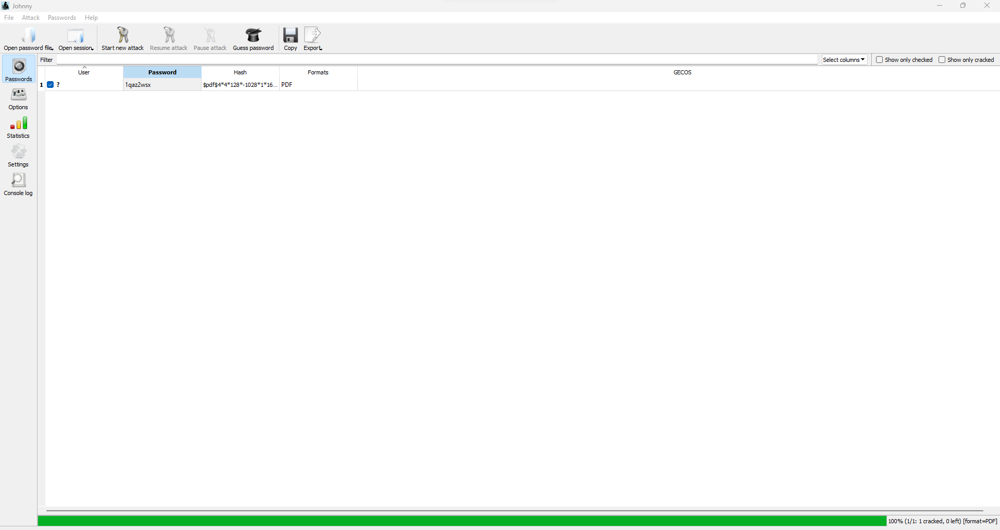
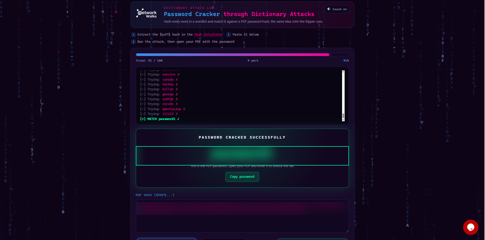

# Week 3: Password Cracking

Password cracking labs for Week 3 of the Networkwalks Cybersecurity internship. Both modules recover the password of an encrypted PDF from its hash, using a different toolset each time.

## Modules completed
| Module | Tools | What I did |
|---|---|---|
| W3-PM1 | John the Ripper, Johnny (GUI) | Extracted each PDF's hash with an online PDF hash extractor, loaded it into Johnny, and ran John the Ripper against it |
| W3-PM2 | Networkwalks Hash Calculator, Networkwalks Password Cracker | Used two browser-based tools made by Networkwalks: one to pull the hash from a locked PDF, the other to crack it |

## How password cracking works here
1. A password-protected PDF stores its password as a hash, a scrambled value, not the password itself.
2. A hash extractor reads the file and outputs that hash (starting with `$pdf$`).
3. A cracking tool tries candidate passwords, hashes each one the same way, and checks for a match.
4. A short or common password is found quickly. A long, random one takes far longer, or may not be found at all.

## Results
Three PDFs were cracked in W3-PM1 and one in W3-PM2, each one confirmed by successfully opening the file and by capturing a flag provided by the lab.

## Evidence

### Johnny: cracked password in John the Ripper's GUI

### Networkwalks Password Cracker: dictionary attack in progress

*The cracked password and hash are blurred; the attack log is left visible.*

## Lessons learned
- **Password cracking is about patience and the right wordlist**, not luck. Weak or common passwords fall quickly under tools like John the Ripper.
- **A hash is not the same as a password.** Recovering the hash is only the first step; cracking it is a separate, sometimes lengthy, process.
- **Strong passwords matter in practice.** The exercise shows directly why long, random, unique passwords resist these attacks far better than short or common ones.

## Ethical use
These exercises were performed on lab files provided for the internship. Only crack passwords on files and systems you own or have explicit permission to test.

Related: [Lab setup](https://github.com/oludaiyeelijahmicheal/cybersecurity-lab-setup) · [Wireshark SOC labs](https://github.com/oludaiyeelijahmicheal/wireshark-soc-labs) · [Week 2 footprinting and scanning](https://github.com/oludaiyeelijahmicheal/week2-footprinting-and-scanning)
